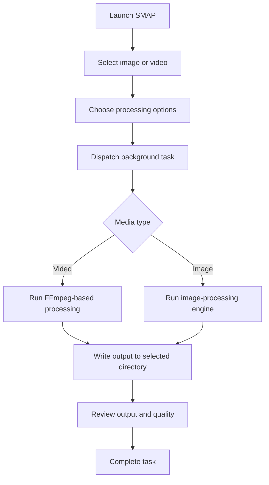

# SMAP
### Smart Media Adaptive Processor

**A desktop workspace for image and video processing.**

Built with Python, PySide6, and media-processing libraries.

---

## Overview

SMAP is a desktop application for processing media files through a graphical interface. The source is organized into separate GUI, processing-engine, and utility modules, with FFmpeg-based video workflows and image-processing components.

## Capabilities

- Video compression with configurable output parameters.
- Image-processing operations through a dedicated processing module.
- File selection and drag-and-drop-oriented workflows.
- User-selected output directories.
- Background task dispatching to keep the interface responsive.
- Image-quality validation utilities, including SSIM-based comparison.
- Logging utilities for application diagnostics.

Available codecs and output options depend on the FFmpeg build installed on the host machine.

## Media-processing workflow

## Technology

| Area | Technology |
| --- | --- |
| Language | Python |
| Desktop UI | PySide6 |
| Media processing | FFmpeg / ffprobe, ffmpeg-python |
| Image processing | OpenCV, scikit-image |
| Validation | SSIM utilities |
| UI styling | Qt Style Sheets |

## Requirements

- Python environment compatible with the installed dependencies.
- FFmpeg and ffprobe installed separately and available on PATH.
- Packages listed in requirements.txt.

## Setup

    git clone https://github.com/gusti111/SMAP-Project.git
    cd SMAP-Project

    python -m venv .venv

Windows:

    .venv\Scripts\activate

macOS / Linux:

    source .venv/bin/activate

Install the Python packages:

    python -m pip install --upgrade pip
    pip install -r requirements.txt

Verify that FFmpeg is available:

    ffmpeg -version
    ffprobe -version

Launch the application:

    python main.py

## Repository structure

    SMAP-Project/
    ├── assets/       # Application assets
    ├── core/         # Image, video, and document processing engines
    ├── gui/          # PySide6 interface and styles
    ├── utils/        # Logging and validation helpers
    ├── main.py       # Application entry point
    └── requirements.txt

## Operational notes

- The repository does not bundle FFmpeg executables.
- Keep original media files backed up when testing conversion workflows.
- Processing time and output quality depend on source media, selected parameters, codecs, and hardware.
- Avoid interpreting a smaller output file as proof of better visual quality; compare quality and playback compatibility as well.

## Project status

A desktop application project under development. Verify the supported input formats, output presets, and edge cases on the target operating system before distributing a release.

## Author

**Gusty Faqikh** · [GitHub](https://github.com/gusti111)